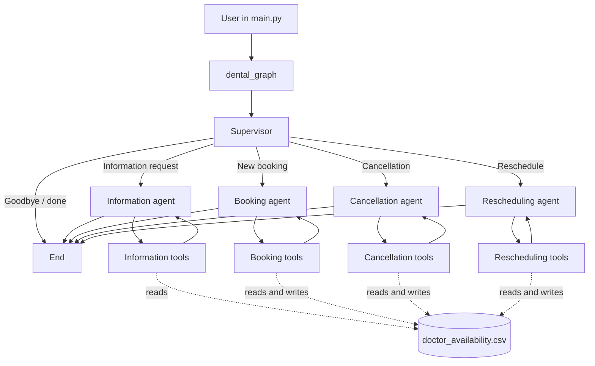

# Dental Appointment Management System

A command-line dental appointment assistant built with LangGraph, LangChain, and Groq. It answers questions about doctors and appointment availability, and helps patients book, cancel, and reschedule appointments. Appointment data is read from and written to a CSV file.

## Features

- Find available appointment slots by specialization, doctor, or date.
- List doctors by specialization and look up a patient's appointments.
- Check a specific doctor's slot before booking.
- Book, cancel, and reschedule appointments through conversational requests.
- Keep the current CLI conversation in memory until the program exits.

## Architecture



### Project layout

```text
.
├── agents/
│   ├── booking_agent.py       # Booking prompts, model calls, and tools
│   ├── cancellation_agent.py  # Cancellation prompts, model calls, and tools
│   ├── info_agent.py          # Information prompts, model calls, and tools
│   ├── rescheduling_agent.py  # Rescheduling prompts, model calls, and tools
│   └── supervisor.py          # Intent classification and graph routing
├── config/
│   └── settings.py            # API key, model, and data-file configuration
├── models/
│   └── state.py               # Shared LangGraph appointment state
├── tools/
│   ├── csv_reader.py          # Read-only appointment lookup tools
│   └── csv_writer.py          # Booking, cancellation, and rescheduling tools
├── workflows/
│   └── graph.py               # Builds and exports the compiled dental_graph
├── doctor_availability.csv   # Appointment schedule and booking records
├── main.py                    # Interactive command-line entry point
├── requirements.txt
└── utils.py                   # Message cleanup for provider compatibility
```

## Workflow

1. `main.py` reads a message and adds it to the conversation history.
2. The supervisor classifies the latest request and routes it to an agent. It uses Groq structured output to return a routing decision.
3. The selected agent either asks for missing information, calls one or more tools, or returns a response.
4. LangGraph executes requested tools through `ToolNode` and sends tool results back to the agent. This loop continues until the agent has no more tool calls.
5. The tools read or update `doctor_availability.csv`; the agent's final response is shown in the terminal.

Booking checks slot availability before writing a booking. Cancellation asks for explicit confirmation unless the user has already confirmed. Rescheduling keeps the same doctor unless the user asks for a different one.

The CLI keeps conversation history only while the process is running. The CSV file stores appointment changes across runs. There is no database or LangGraph checkpointer configured.

## Prerequisites

- Python 3.10 or newer.
- A Groq API key with access to the configured model.
- `doctor_availability.csv` in the project root (included in this project).
- Internet access for Groq API requests.

## Installation

Run these commands from the project directory.

### macOS / Linux

```bash
python3 -m venv .venv
source .venv/bin/activate
python -m pip install --upgrade pip
pip install -r requirements.txt
```

### Windows PowerShell

```powershell
py -m venv .venv
.\.venv\Scripts\Activate.ps1
python -m pip install --upgrade pip
pip install -r requirements.txt
```

## Configuration

Create a `.env` file in the project root and add your Groq key:

```env
GROQ_API_KEY=your-groq-api-key
GROQ_MODEL=openai/gpt-oss-20b
TEMPERATURE=0
```

`GROQ_API_KEY` is required. `GROQ_MODEL` and `TEMPERATURE` are optional; the defaults are `openai/gpt-oss-20b` and `0`. Keep `.env` private and do not commit API keys to source control.

The CSV path is resolved from the project structure as `<project-root>/doctor_availability.csv`.

## Run the application

```bash
python main.py
```

Example requests:

```text
Show available slots for an orthodontist
Book patient 1000082 with Emily Johnson on 5/10/2026 9:00
Cancel appointment for patient 1000082 at 5/10/2026 9:00
Reschedule patient 1000082 from 5/10/2026 9:00 to 5/12/2026 10:00
What appointments does patient 1000048 have?
```

Enter `quit` or `exit` to close the application. Dates and times use `M/D/YYYY H:MM` (for example, `5/10/2026 9:00`).

## Technology stack

| Technology | Use |
|---|---|
| Python | Application and CLI |
| LangGraph | Workflow graph, routing, and agent/tool loops |
| LangChain | Prompts, chat models, and tool interfaces |
| LangChain Groq | Groq chat model integration |
| Groq API | Language model inference |
| Pydantic | Validates the supervisor's structured routing decision |
| pandas | Reads, filters, and updates appointment records |
| CSV | Local appointment data storage |
| python-dotenv | Loads local configuration from `.env` |

## Appointment data

The CSV file uses these columns:

| Column | Meaning |
|---|---|
| `date_slot` | Appointment date and time |
| `specialization` | Dentist specialty, such as `orthodontist` |
| `doctor_name` | Doctor assigned to the slot |
| `is_available` | `TRUE` when open; `FALSE` when booked |
| `patient_to_attend` | Patient ID for a booked slot; blank when open |

The reader returns at most 20 available slots per query. Doctor name matching is case-insensitive and accepts common titles such as `Dr.`. The writer updates the CSV in place, so make a backup before using real appointment data.

**Sample-data note:** the application filters availability using `is_available`; it does not currently exclude slots dated in the past. Refresh the CSV with current future slots before relying on availability results.

## Troubleshooting

- **Missing API key:** confirm `.env` is in the project root and the variable is named `GROQ_API_KEY`.
- **Unknown model or access error:** check that the model in `GROQ_MODEL` is available to your Groq account.
- **Rate limit or service error:** wait and retry according to the error returned by Groq. The supervisor and agent/tool loop can make multiple model requests for one user turn.
- **CSV not found:** run `main.py` from this project checkout and confirm `doctor_availability.csv` is in the project root.
- **No slots returned:** check the selected doctor's spelling, specialization, `is_available` values, and the dates in the CSV.

## Current scope and limitations

- This is a local command-line project; it does not provide a web UI, authentication, or a database.
- Patient IDs are used to find and modify bookings, but are not validated against a separate patient registry.
- CSV writes are direct and are not protected by a database transaction or concurrent-write lock.
- Appointment changes are made only after the relevant agent invokes a write tool; keep backups of important data.
